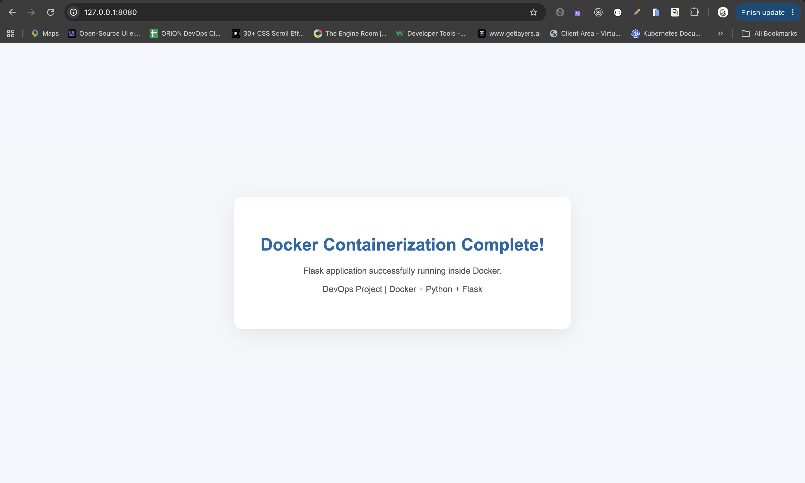
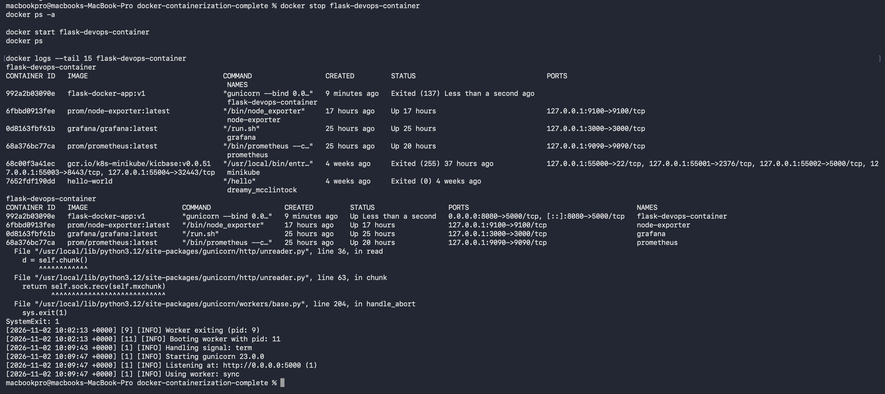

# Docker Containerization Complete

A DevOps project demonstrating Docker containerization of a Python Flask application.

## Technologies
- Python 3.12
- Flask
- Gunicorn
- Docker

## Project Files
- app.py - Flask web application
- requirements.txt - Python dependencies
- Dockerfile - Docker image configuration
- screenshots/ - Project evidence

## Build Docker Image

docker build -t flask-docker-app:v1 .

## Run Docker Container

docker run -d --name flask-devops-container -p 8080:5000 flask-docker-app:v1

Application: http://127.0.0.1:8080

Health endpoint: http://127.0.0.1:8080/health

## Container Management

docker ps
docker logs flask-devops-container
docker stop flask-devops-container
docker start flask-devops-container
docker rm -f flask-devops-container

## Docker Optimization
- Lightweight Python Alpine image
- Docker layer caching
- Non-root application user
- pip --no-cache-dir
- Gunicorn application server

## Verification
- Flask homepage returned HTTP 200 OK.
- Health endpoint returned HTTP 200 OK.
- Docker image built successfully.
- Container lifecycle tested.
- Image disk usage: approximately 102 MB.

## Screenshots

## Completed Tasks
- [x] Prepare Flask application
- [x] Author Dockerfile
- [x] Build Docker image
- [x] Run container and map ports
- [x] Manage container lifecycle
- [x] Optimize Docker image
- [x] Document project

## Automated Application Testing

The Flask application includes three automated tests using Python's built-in unittest framework.

Run tests inside Docker:

    docker run --rm -v "$PWD/tests:/app/tests:ro" -w /app flask-docker-app:v1 python -m unittest discover -s tests -v

Results: 3 tests passed, 0 failures.

## Docker Build Verification

Build the image:

    docker build -t flask-docker-app:v1 .

Inspect the image:

    docker image inspect flask-docker-app:v1

The image uses Python 3.12 Alpine and runs as a non-root user.

Verified image size: approximately 101.9 MB.

## Container Port Mapping

Run the application:

    docker run -d --name flask-devops-container -p 8080:5000 flask-docker-app:v1

Access the application at:

http://127.0.0.1:8080

Check application health:

    curl -i http://127.0.0.1:8080/health

## Container Lifecycle

    docker ps
    docker logs flask-devops-container
    docker stop flask-devops-container
    docker start flask-devops-container
    docker rm -f flask-devops-container

## Build and Verification Evidence

- [Docker build log](docs/logs/docker-build.log)
- [Image inspection](docs/logs/image-inspection.log)
- [Image history](docs/logs/image-history.log)
- [Automated test results](docs/logs/test-results.log)
- [Running container](docs/logs/container-running.log)
- [HTTP health check](docs/logs/health-check.log)
- [Application logs](docs/logs/container-logs.log)

## Screenshots

- [Flask application in browser](screenshots/flask-browser.png)
- [Container lifecycle](screenshots/container-lifecycle.png)
